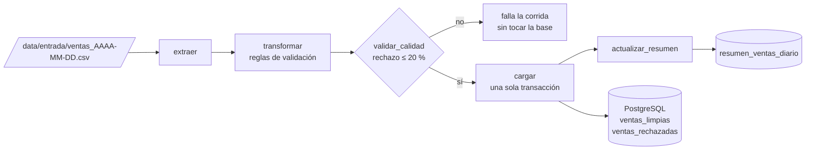
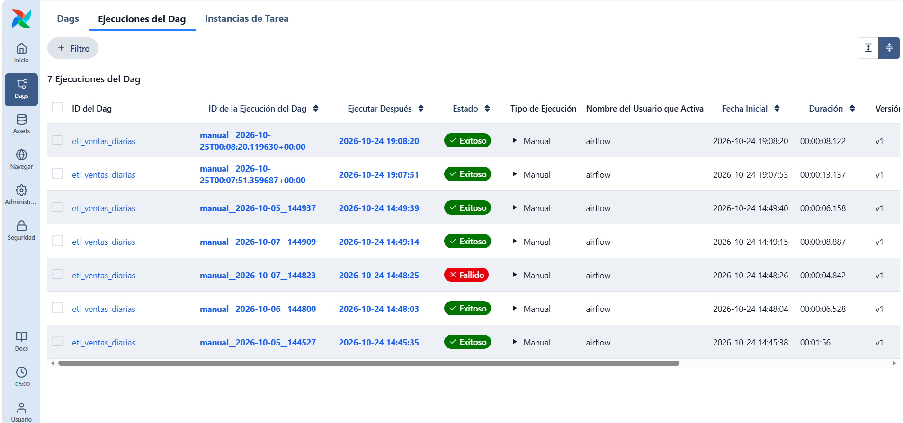
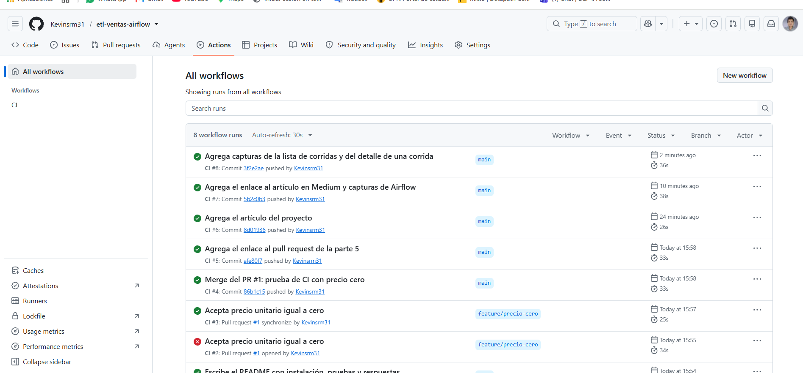

# ETL de ventas diarias con Airflow, pruebas y CI

[](https://github.com/Kevinsrm31/etl-ventas-airflow/actions/workflows/ci.yml)

Pipeline orquestado con **Apache Airflow 3.3.2** que toma el archivo CSV de
ventas de una fecha, separa las filas válidas de las que tienen problemas
(guardando el motivo), frena la carga si el archivo viene demasiado sucio y
deja el resultado en **PostgreSQL** de forma idempotente. Cada cambio pasa por
pruebas automáticas en **GitHub Actions** antes de llegar a `main`.

📝 Artículo en Medium: [Pipeline ETL de ventas con Airflow, pruebas y CI: validar antes de cargar](https://medium.com/@kevinsrm19/pipeline-etl-de-ventas-con-airflow-pruebas-y-ci-validar-antes-de-cargar-759e2e20d627)

## Caso de uso

Una cadena de tiendas de tecnología con locales en tres regiones (norte, sur y
centro) recibe cada noche un CSV con las ventas del día. Hasta ahora alguien
lo abría en Excel, lo limpiaba a mano y pegaba los totales en un reporte, sin
registro de qué filas se descartaban ni por qué. Este pipeline reemplaza ese
proceso manual por uno trazable y repetible.

## Arquitectura



| Tarea | Qué hace |
|---|---|
| `extraer` | Lee el parámetro `fecha`, ubica `ventas_<fecha>.csv` y falla con un mensaje claro si no existe. |
| `transformar` | Aplica las reglas de validación y separa filas limpias y rechazadas. |
| `validar_calidad` | Calcula la tasa de rechazo. Si supera el 20 % la corrida falla. **No reintenta.** |
| `cargar` | En una sola transacción: crea las tablas si faltan, borra la fecha, inserta con parámetros y verifica los conteos. |
| `actualizar_resumen` | Recalcula `resumen_ventas_diario` solo para la fecha cargada (ventas, unidades y monto por región). |

### Reglas de validación

A cada valor se le quitan los espacios de los extremos y las reglas se
aplican en orden; la fila se rechaza con el **primer** motivo que falle:

| # | Regla | Motivo |
|---|---|---|
| 1 | La línea tiene exactamente las 6 columnas (un `45,50` sin comillas la parte en 7) | `columnas_incorrectas` |
| 2 | `id_venta` tiene solo dígitos y es mayor que 0 | `id_invalido` |
| 3 | `id_venta` no apareció antes en el archivo (`070001` = `70001`) | `id_duplicado` |
| 4 | `fecha` es la fecha que se procesa | `fecha_distinta` |
| 5 | `region` es norte, sur o centro | `region_invalida` |
| 6 | `producto` no está vacío | `producto_vacio` |
| 7 | `cantidad` tiene solo dígitos y es mayor que 0 | `cantidad_invalida` |
| 8 | `precio_unitario` son dígitos con punto decimal opcional y, redondeado a 2 decimales, es mayor que 0 | `precio_invalido` |

Las filas válidas se normalizan (`" SUR"` → `Sur`, `"AURICULARES"` →
`Auriculares`) y se calcula `total = cantidad × precio_unitario`.

Las reglas viven en `dags/ventas/reglas.py`, un módulo que **no importa nada
de Airflow**: así se prueban con pytest en menos de un segundo.

## Estructura del repositorio

```
├── dags/
│   ├── etl_ventas_diarias.py     # DAG: extraer -> transformar -> validar_calidad -> cargar -> actualizar_resumen
│   └── ventas/reglas.py          # lectura del CSV y reglas de validación (sin Airflow)
├── data/
│   ├── entrada/                  # CSV del 5, 6 y 7 de octubre de 2026
│   └── correcciones/             # versión corregida del archivo del 7
├── tests/
│   ├── test_reglas.py            # pruebas unitarias de las reglas
│   └── test_integridad_dag.py    # el DAG carga, no tiene ciclos y está bien configurado
├── sql/verificacion.sql          # consultas para revisar cada corrida
├── evidencias/                   # capturas y salida de las corridas
├── .github/workflows/ci.yml      # pytest en cada push y pull request a main
├── docker-compose.yaml, Dockerfile, preparar_entorno.py
└── requirements*.txt, constraints-3.12.txt
```

## Cómo levantarlo

Requisitos: Docker Desktop y Python 3.

```bash
python preparar_entorno.py      # crea .env con claves propias y las carpetas logs/, config/ y plugins/
docker compose build
docker compose up airflow-init
docker compose up -d --wait
```

Airflow queda en http://localhost:8080 (usuario `airflow` / `airflow`). Si el
puerto 8080 ya está ocupado, cambia `AIRFLOW_PORT` en el `.env`.

Para procesar una fecha: activa el DAG `etl_ventas_diarias` y dispáralo con
**Trigger** indicando la fecha en el formulario. Desde la terminal:

```bash
docker compose exec airflow-scheduler airflow dags trigger etl_ventas_diarias --conf '{"fecha": "2026-10-05"}'
```

Para revisar el resultado:

```bash
docker compose exec -T datapath-db psql -U dp_user_pg -d datapath_pg < sql/verificacion.sql
# PowerShell:
Get-Content sql/verificacion.sql | docker compose exec -T datapath-db psql -U dp_user_pg -d datapath_pg
```

## Cómo correr las pruebas

Dentro del contenedor:

```bash
docker compose exec airflow-scheduler pytest
```

O en un entorno virtual local con Python 3.12, igual que en el CI:

```bash
pip install -r requirements-dev.txt --constraint constraints-3.12.txt
pytest
```

Son 67 pruebas: 62 de las reglas (cada motivo de rechazo, normalización,
duplicados, orden de las reglas, columnas de más leyendo un CSV real y el
umbral de calidad) y 5 de integridad del DAG.

## Resultados

| Archivo | Filas leídas | Válidas | Rechazadas | ¿Pasa el control? |
|---|---|---|---|---|
| 2026-10-05 | 46 | 41 | 5 | Sí |
| 2026-10-06 | 53 | 46 | 7 | Sí |
| 2026-10-07 (original) | 41 | 17 | 24 | **No** (58.5 % de rechazo) |
| 2026-10-07 (corregido) | 41 | 39 | 2 | Sí |

Tras las cinco corridas (incluida la repetición del 5 de octubre),
`ventas_limpias` tiene **126 filas sin ids repetidos** y
`resumen_ventas_diario` tiene **9 filas** (3 fechas × 3 regiones). La salida
completa está en [`evidencias/verificacion.txt`](evidencias/verificacion.txt).



Las cinco corridas de la parte 4 son las de abajo (`manual__2026-10-05__…` a
`manual__2026-10-05__144937`), incluida la del 7 de octubre que falla en
`validar_calidad`. Las dos de arriba son disparos adicionales desde la
interfaz con la fecha por defecto (2026-10-05): después de procesar ese día
tres veces, `ventas_limpias` sigue con 126 filas sin ids repetidos.

Otras capturas en [`evidencias/`](evidencias/): el formulario de Trigger con
el parámetro `fecha`, el detalle de una corrida con sus cinco tareas y el
panel de inicio de Airflow.

## Preguntas

**1. ¿Por qué falló la corrida del 7 de octubre? ¿Qué habría quedado en la base si no existiera `validar_calidad`?**

Buena parte del archivo original tenía el precio con coma decimal
(`"45,50"`), como cuando se guarda desde un Excel con configuración regional
en español: 22 filas se rechazaron por `precio_invalido`, una por una cantidad
escrita como texto (`dos`) y otra por una región inexistente (`Oeste`). En
total, 24 de 41 filas rechazadas, un 58.5 %, muy por encima del 20 % permitido. Sin el
control se habrían cargado solo las 17 filas válidas, que eran todas de la
región Norte: el reporte del día habría mostrado 24,821.70 en lugar de
65,642.70, con Centro y Sur sin ventas, y nada habría avisado del problema.

**2. ¿Qué hace que repetir una fecha no duplique ventas? ¿Qué pasaría si `cargar` solo hiciera `INSERT`?**

`cargar` borra todo lo de esa fecha en `ventas_limpias` y `ventas_rechazadas`
y vuelve a insertar, dentro de una sola transacción: el resultado es siempre
el mismo sin importar cuántas veces se corra, y si algo falla la fecha queda
como estaba. El resumen se recalcula igual, solo para esa fecha. Si `cargar`
solo hiciera `INSERT`, la segunda corrida chocaría con la llave primaria de
`id_venta` y fallaría; sin esa llave, cada repetición duplicaría las ventas y
los totales del resumen.

**3. ¿Por qué las pruebas del CI pueden correr sin PostgreSQL ni el scheduler? Nombra una cosa que esas pruebas no comprueban.**

Las reglas están en un módulo de Python puro que no depende de Airflow ni de
la base, y las pruebas del DAG solo lo cargan con `DagBag`, que lee los
archivos de `dags/` sin ejecutar tareas: `PostgresHook` recién se crea cuando
una tarea corre. Lo que no comprueban es que el SQL de `cargar` y
`actualizar_resumen` funcione contra un PostgreSQL real (tipos, restricciones
`CHECK`, la transacción), ni que la conexión o la carpeta montada existan.
Eso se valida con las corridas de la parte 4.

**4. ¿Por qué tiene sentido que `validar_calidad` no reintente y que `extraer` sí?**

Si el archivo viene sucio, revisarlo de nuevo 15 segundos después da
exactamente el mismo resultado: reintentar solo retrasa el aviso. `extraer`,
en cambio, puede fallar por causas pasajeras, como que el archivo todavía se
esté copiando a la carpeta compartida o que el volumen tarde en montarse, y
un reintento puede resolverlo sin intervención.

## Integración continua

El workflow [`ci.yml`](.github/workflows/ci.yml) corre en cada push a `main` y
en cada pull request hacia `main`: instala Python 3.12, las dependencias de
`requirements-dev.txt` con las constraints de Airflow y ejecuta `pytest`.

**Pull request de prueba:** [#1 — Acepta precio unitario igual a cero](https://github.com/Kevinsrm31/etl-ventas-airflow/pull/1).
La rama `feature/precio-cero` cambió la regla del precio para aceptar 0; el CI
quedó en rojo señalando `test_precio_invalido[0]`, `[0.00]` y `[0.004]`. Tras
revertir el cambio en la misma rama pasó a verde y se hizo el merge.



## Tecnologías

Apache Airflow 3.3.2 (TaskFlow API) · PostgreSQL 16 · Python 3.12 · pytest ·
GitHub Actions · Docker / Docker Compose.

## Autor

Kevin Reyes — [LinkedIn](https://www.linkedin.com/in/kevin-steven-reyes-morocho-/)
